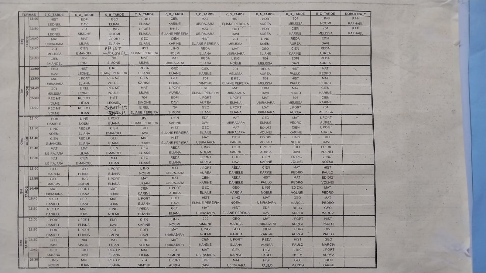

# 🏫 Ensalamento · Escola Santo Agostinho

[](https://pages.github.com/)
[]()
[]()
[]()
[](./LICENSE)
[]()

> Sistema web leve, intuitivo e responsivo para consulta ágil de salas, turmas e horários de aulas dos professores e alunos da **Escola Santo Agostinho**. Desenvolvido em arquivo único (*single-file*), sem dependências externas e pronto para hospedar no **GitHub Pages** ou executar diretamente no navegador.

---

## 📸 Visão Geral e Referência Visual

O sistema foi concebido para digitalizar e aprimorar a experiência dos murais físicos e cronogramas em papel da escola, permitindo que professores, coordenadores, alunos e pais encontrem qualquer aula em segundos pelo celular, tablet ou computador.

| Mural Físico Original (`Ensalamento.jpeg`) | Cronograma em Papel (`Cronograma_de_Aulas_Tarde.jpeg`) |
| :---: | :---: |
|  |  |

---

## ✨ Principais Funcionalidades

### 1. 🔍 Consulta por Professor(a)
* **Lista Completa A-Z:** Chips clicáveis de todos os professores da escola.
* **Busca Global Inteligente:** Campo de pesquisa unificado com *autocomplete*, tolerante a acentos e maiúsculas/minúsculas. Pressione `/` no teclado para focar na busca imediatamente.
* **Linha do Tempo da Aula:** Identificação visual automática da aula que está ocorrendo **AGORA**, da **PRÓXIMA** aula a seguir e das aulas já **ENCERRADAS**.
* **Contagem Regressiva:** Exibe minutos restantes para o início ou encerramento de cada aula em tempo real.
* **Opção de Exibição de Janelas:** Checkbox para visualizar horários livres (janelas de aula).

### 2. 👥 Consulta por Turma e Piso
* Navegação categorizada por andares do colégio:
  * **Piso 1:** Turmas 8º A, 7º C e 7º A.
  * **Piso 2:** Turmas 7º D, 6º A, 6º B e 7º B.
  * **Piso 3:** TV Interativa / Robótica, 9º C, 8º B e 8º C.
* Na consulta por turma, o cartão identifica automaticamente o professor responsável por ministrar a aula no horário.

### 3. 🕒 Visão Panorâmica "Agora na Escola"
* Apresenta um painel em tempo real da ocupação simultânea de todas as salas de aula divididas por piso.
* Mostra se as turmas estão em aula, no intervalo ou com aulas encerradas naquele instante.

### 4. 🗺️ Mini-Mapa SVG Dinâmico do Andar
* Cada box de aula inclui uma reprodução visual estilizada em **SVG puro** representando o corredor do piso:
  * **Badge do Andar:** Selo colorido à esquerda (`PISO 1`, `PISO 2` ou `PISO 3`) com ícone de escada/degraus.
  * **Salas do Corredor:** Enfileiramento de todas as salas daquele andar.
  * **Destaque Visual:** A sala/turma onde a aula acontece ganha destaque com fundo branco, contorno nítido e indicador inferior, enquanto as demais salas vizinhas ficam esmaecidas com opacidade suave.
  * **Responsividade Refinada:** Em telas de smartphones ocupa 100% da largura útil do box; em desktops e telas maiores mantém uma largura contida e amigável (sem esticamento desproporcional).

### 5. ♿ Acessibilidade e Modos de Exibição
* **Controle de Escala de Fonte (A- / A+):** Ajuste fino do tamanho do texto (de 85% a 130%), com persistência automática da preferência no `localStorage`.
* **Modo Tela Cheia (Fullscreen):** Botão dedicado na barra superior, ideal para totens de autoatendimento, smart TVs e quiosques nos corredores da escola.
* **Suporte a Redução de Movimento:** Respeita a diretiva `prefers-reduced-motion` para usuários sensíveis a animações.
* **Modo de Impressão Limpo:** Folha de estilos `@media print` otimizada que oculta menus interativos e imprime a grade de forma limpa.

### 6. 🧪 Simulador de Data e Hora Integrado
* Permite testar o comportamento do ensalamento em qualquer dia e horário do ano.
* Acessível diretamente pelo parâmetro de URL `#simulador` ou `#diagnostico`.

---

## 🛠️ Arquitetura Técnica

```
EnsalamentoSantoAgostinho/
├── index.html       # Aplicação completa (HTML5 + CSS3 + JS Vanilla)
├── README.md        # Documentação completa do projeto
├── LICENSE          # Licença livre MIT
├── .gitignore       # Arquivos e pastas excluídos do versionamento
└── docs/
    └── img/         # Imagens de referência dos murais físicos
```

* **Single-File Architecture:** Todo o sistema reside no [`index.html`](./index.html). Não há dependência de servidores Node.js, compilação Webpack, bundlers ou frameworks externos (React, Vue, Angular).
* **Zero Dependências:** Funciona 100% offline nativamente. Basta baixar e clicar duas vezes para abrir em qualquer navegador moderno (Chrome, Edge, Firefox, Safari).
* **Desempenho Extremo:** Carregamento inicial em menos de 50ms, renderização DOM instantânea via JS puro e zero requisições bloqueantes.

---

## 🔒 Segurança e Privacidade

Este projeto foi construído seguindo diretrizes rigorosas de segurança na web:

1. **Content Security Policy (CSP) Estrita:**
   O cabeçalho meta CSP está configurado com a política de menor privilégio:
   ```html
   <meta http-equiv="Content-Security-Policy"
         content="default-src 'none'; script-src 'unsafe-inline'; style-src 'unsafe-inline'; img-src data:; connect-src 'none'; base-uri 'none'; form-action 'none'">
   ```
   * Impede carregamento de scripts externos, injeções maliciosas e conexões de rede não autorizadas.
2. **Zero Telemetria e Coleta de Dados:**
   * O sistema não possui rastreadores, analytics, cookies de terceiros ou formulários com envio externo.
   * As preferências de fonte e aba são salvas exclusivamente no navegador do próprio usuário via `localStorage`.
3. **Prevenção contra XSS:**
   * Toda manipulação de interface utiliza métodos seguros do DOM (`textContent`, `createElementNS`, `setAttribute`), evitando o uso perigoso de `innerHTML`.
4. **Política de Referrer Estrita:**
   * Definido como `no-referrer` para não vazar URLs em navegações internas.

---

## 🚀 Como Executar e Hospedar

### Execução Local (Sem Servidor)
1. Clone ou baixe este repositório:
   ```bash
   git clone https://github.com/SEU-USUARIO/EnsalamentoSantoAgostinho.git
   ```
2. Abra a pasta e dê um duplo clique no arquivo [`index.html`](./index.html).
3. O sistema funcionará imediatamente em seu navegador padrão.

### Hospedagem Gratuita no GitHub Pages
1. Crie um repositório no seu GitHub e faça o push dos arquivos deste projeto.
2. Acesse seu repositório no GitHub e clique em **Settings** (Configurações).
3. No menu lateral esquerdo, clique em **Pages**.
4. Em **Build and deployment** > **Branch**:
   * Selecione a branch `main` (ou `master`).
   * Selecione a pasta `/ (root)`.
   * Clique em **Save**.
5. Em poucos instantes, o GitHub Pages fornecerá o link público seguro (`https://seu-usuario.github.io/EnsalamentoSantoAgostinho/`).

---

## 🤝 Como Contribuir

Contribuições da comunidade escolar, professores e desenvolvedores são muito bem-vindas!

1. Faça um **Fork** do projeto.
2. Crie uma branch para sua funcionalidade ou correção:
   ```bash
   git checkout -b feature/nova-funcionalidade
   ```
3. Faça suas alterações com código limpo e documentado.
4. Confirme suas alterações (*commit*):
   ```bash
   git commit -m "feat: Adiciona suporte a novo turno matutino"
   ```
5. Envie para o seu repositório remoto (*push*):
   ```bash
   git push origin feature/nova-funcionalidade
   ```
6. Abra um **Pull Request** detalhando as melhorias realizadas.

---

## 📄 Licença Livre (Open Source)

Este projeto está licenciado sob a **Licença MIT** — você é livre para usar, estudar, modificar, distribuir e adaptar este software para qualquer instituição educacional ou privada.

Consulte o arquivo [`LICENSE`](./LICENSE) para o texto completo da licença.

---

<div align="center">
  <b>Escola Santo Agostinho</b><br>
  <i>"Cada sala, uma nova oportunidade de aprender e crescer!"</i><br>
  <b>Organização hoje, sucesso sempre! ⭐</b>
</div>
